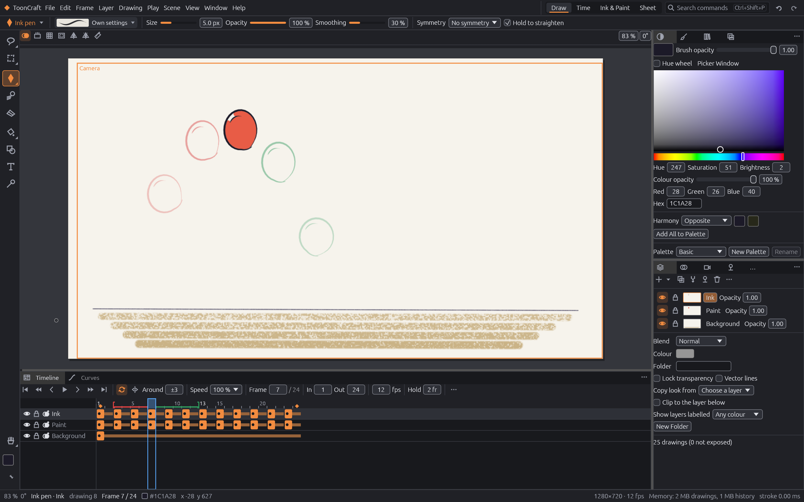
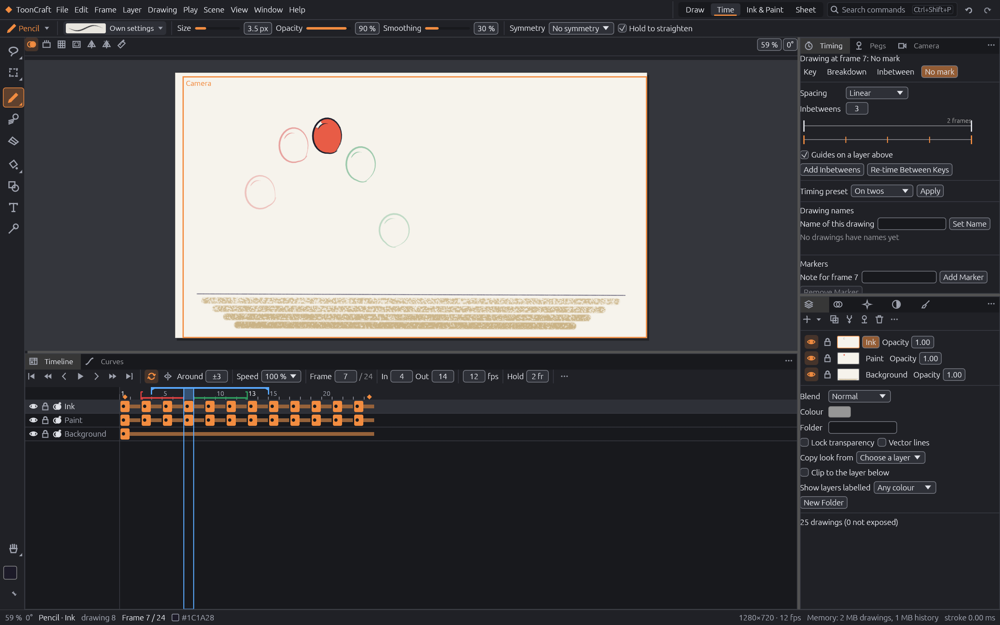
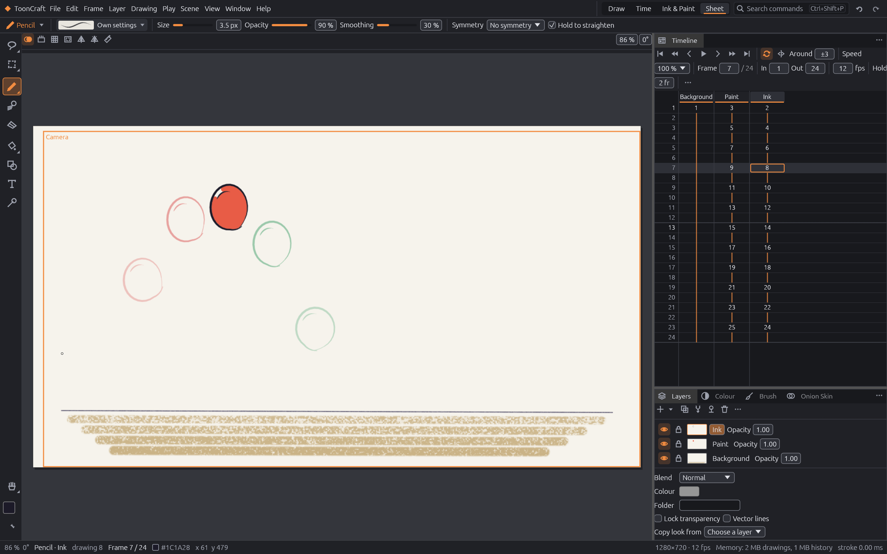
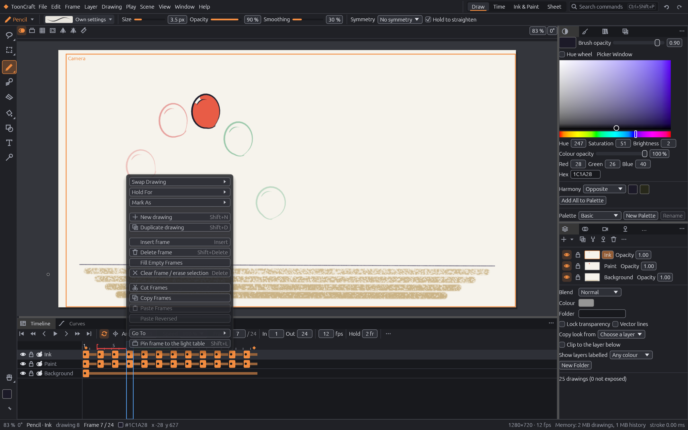
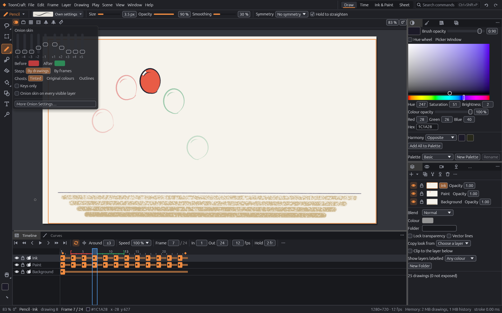
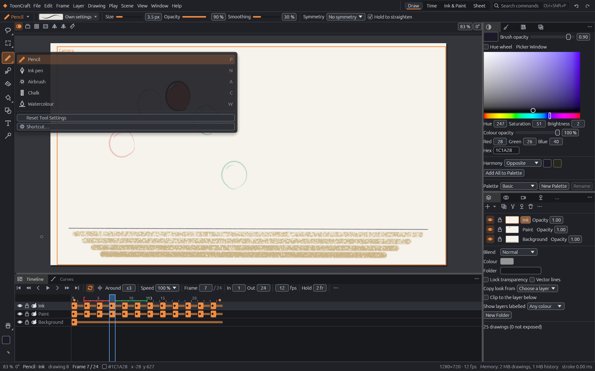

<p align="center">
  
</p>

<h1 align="center">ToonCraft</h1>

<p align="center"><b>Hand-drawn, frame-by-frame animation.</b></p>

<p align="center">
Open-source raster animation in pure Rust: draw with pressure-sensitive pencils, inks and chalk on
a GPU canvas, time your drawings on an exposure sheet, flip with onion skin and a light table,
colour with a gap-closing paint bucket and play it back in real time. One of the ArtCraft Crafting
Apps, next to AniCraft (vector animation), BoardCraft (storyboards) and FilmCraft (editing).
</p>

<p align="center">
  
  
  
</p>



[What works today](#what-works-today) · [Getting started](#getting-started) ·
[Agents and CLI](#agents-and-cli) · [Roadmap](#roadmap) · [License](#license-and-credits)

## What works today

- **Workspace:** one top bar with the menus, the Draw · Time · Ink & Paint · Sheet workspaces (each
  keeps your panel changes; Reset and Save As in Window ▸ Workspace), command search (Ctrl+Shift+P)
  and undo / redo. A tool rail with groups and flyouts that remember the last variant; a tool
  options bar with stroke-preview presets and drag-or-type fields; panels in tab stacks with a glyph,
  a name and a `⋯` menu. One command registry feeds the menu bar, the right-click menus, command
  search and the shortcut editor, so every command has one name, icon and key.
- **Right-click everywhere:** the canvas, a selection, timeline cells, the ruler, layer rows, tools,
  panel tabs, swatches, brush presets and library items have menus (two levels at most; unavailable
  items stay and say why); they also open with the Menu key or Shift+F10.
- **Timeline header and canvas header:** icon transport, loop, play around and speed with inline
  frame, in, out, fps and hold fields; icon toggles above the canvas (onion skin, light table, field
  guide, safe areas, mirror, symmetry, rulers) that open their settings on right-click, including
  per-step onion opacity from −5 to +5; drag the loop range on the ruler.
- **Canvas:** tiled, sparse, GPU-composited; pan, zoom about the pointer, rotate, mirror; up to
  16384 px a side.
- **Brushes:** pencil with paper grain, ink pen, airbrush, chalk, eraser, image tips and
  `.toonbrush` presets; pen pressure, tilt and the eraser end (Linux X11, macOS, Windows); speed
  dynamics, smoothing and a "steady line" stabilizer; strokes never darken where dabs overlap.
- **Selection and shapes:** lasso and rectangle selections you move, scale, rotate and flip live;
  lines, rectangles and ellipses.
- **Exposure sheet:** layers with keys, holds and blanks; new / duplicate drawing, insert / delete
  frame, drag a drawing's cells to change its hold, re-time on 1s–4s without losing drawings; select
  ranges across layers, copy / cut / paste them (linked or as new drawings), reverse and repeat them.
- **Layers:** blend modes, folders, label colours, timeline thumbnails.
- **Camera:** eased pan, zoom and rotation keys; exports render through it.
- **Sound:** a soundtrack with its waveform in the timeline, frame-by-frame scrubbing and sound in
  the MP4.
- **Onion skin and light table:** before / after counts, tints, falloff, by drawings or by frames,
  every layer or one; pin any frame of any layer under the drawing.
- **Colour:** paint bucket with gap closing and spread under lines, on the line layer or a paint
  layer underneath; HSV picker, swatches, eyedropper.
- **Playback** at the shot's frame rate, looping, clock-driven.
- **Safety:** unlimited undo (memory-bounded), journaled atomic saves with a backup, Save New
  Version, background autosave with crash recovery, a property-tested loader.
- **Works with other apps:** layered PSD / PSB and OpenRaster in and out, XDTS exposure sheets with
  their drawing folders in and out, ProRes 4444 with alpha and per-layer PNG sequences for
  compositing, MP4 (H.264 + AAC), GIF, animated PNG; all built in, no external tools
  ([docs/interop.md](docs/interop.md)).
- **Yours to keep:** open source, offline, no account, no tiers, no watermark; a 4K, 240-drawing shot
  plays in real time and loads in a tenth of a second.
- **Accessibility:** every control named for screen readers, the canvas and exposure-sheet cells
  included; everything works from the keyboard, including drawing (the keyboard pen).



| Sheet workspace | Right-click on a timeline cell |
|---|---|
|  |  |
| **Onion skin settings** (right-click the onion toggle) | **A tool group's flyout** (hold or right-click a tool) |
|  |  |

## Getting started

```bash
cargo run --release -p tooncraft -- --demo
```

Keys: P pencil, N ink, A airbrush, C chalk, E eraser, F fill, I picker, S select, U shapes, H hand,
Z zoom, R rotate view · Enter play · , . frames · Shift+N new drawing · Shift+D duplicate · + − hold ·
O onion skin · [ ] brush size · Ctrl+[ ] rotate · F6 canvas ↔ sheet · Ctrl+Shift+P find a command · Menu or Shift+F10
opens the right-click menu of the focused control. Help ▸ Keyboard Shortcuts lists them all and
remaps them; Help ▸ Icon Reference shows every icon.

`cargo xtask ci` runs every check (fmt, clippy, tests, layering, assets, progress, parity, strings,
licences).

## Agents and CLI

```bash
cargo run -p tooncraft-cli -- demo shot.toon
cargo run -p tooncraft-cli -- run shot.toon commands.jsonl
cargo run -p tooncraft-cli -- export shot.toon --mp4 shot.mp4
cargo run --release -p tooncraft-cli -- bench
```

Every action is an engine command ([docs/control-protocol.md](docs/control-protocol.md)).

## Roadmap

[ROADMAP.md](ROADMAP.md) · [docs/roadmap.md](docs/roadmap.md) · [docs/gaps.md](docs/gaps.md) ·
[docs/target-app-parity.md](docs/target-app-parity.md) · [docs/performance.md](docs/performance.md)

## License and credits

MIT OR Apache-2.0 ([LICENSE-MIT](LICENSE-MIT), [LICENSE-APACHE](LICENSE-APACHE)); see
[NOTICE](NOTICE) and [ATTRIBUTION.md](ATTRIBUTION.md). ToonCraft is a clean-room project and is not
affiliated with any other animation software vendor.
